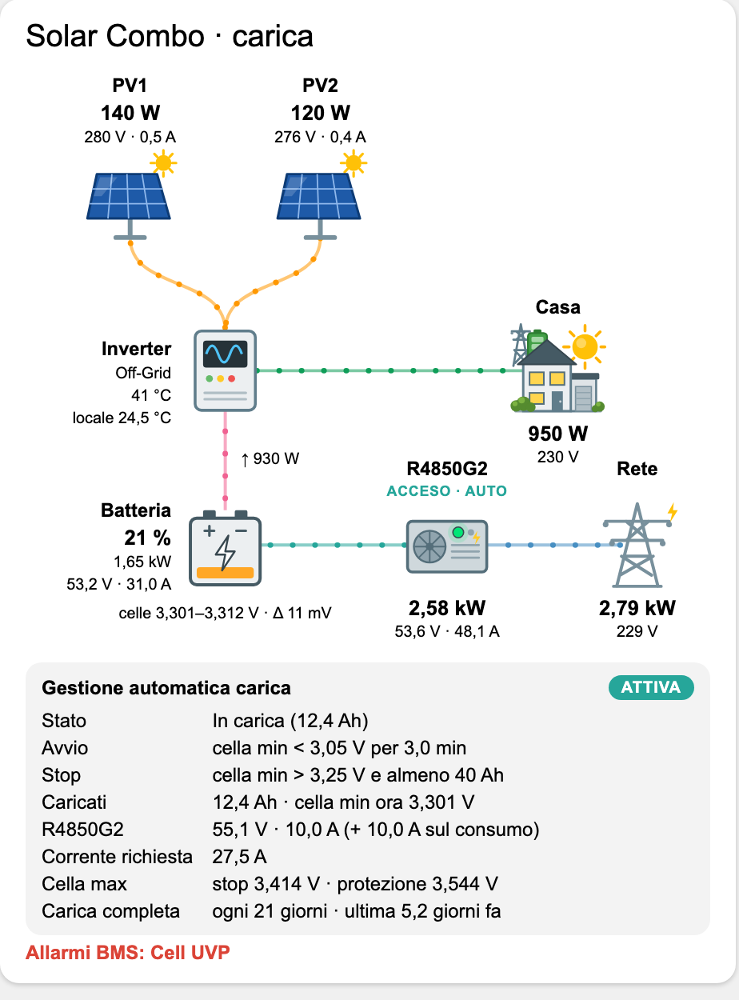

# Solar Combo Card

Card Lovelace per Home Assistant con il flusso di energia dell'impianto **solar-combo** (firmware `esphome/solar-combo.yaml`):

- 2 stringhe fotovoltaiche (PV1, PV2) dell'inverter;
- inverter Easun SMG II, sempre in off-grid;
- batteria con JK-BMS;
- caricabatterie Huawei R4850G2;
- casa, cioè l'uscita AC dell'inverter;
- rete del gestore, che entra **solo** nel R4850G2.



Ogni elemento è un'illustrazione SVG disegnata nella card, senza file esterni. Alcuni dettagli seguono lo stato:

- il sole sul pannello quando la stringa produce;
- le finestre accese quando la casa consuma;
- dietro la casa, un sole quando la casa va a solare (le stringhe producono) e una batteria quando va a batteria (la batteria dà energia all'inverter); compaiono tutti e due quando il fotovoltaico copre solo una parte del consumo. Se la casa va a batteria mentre il R4850G2 carica dalla rete, accanto alla batteria compare anche un traliccio: l'energia arriva dalla rete attraverso il bus della batteria;
- il riempimento della batteria in base al SOC (rosso sotto il 20%, arancio sotto il 40%), con il fulmine quando è in carica;
- il LED verde, con un alone che pulsa, quando il R4850G2 è acceso;
- la scintilla sul traliccio quando la rete fornisce energia.

| Flusso | Potenza mostrata |
|---|---|
| PV1, PV2 → inverter | potenza di ogni stringa |
| inverter → casa | *SMG-II Output Active Power* |
| inverter ↔ batteria | *BMS Potenza* − *R4850G2 Output Power*: il R4850G2 carica la batteria direttamente sul bus DC, quindi la sua potenza va tolta dal totale del BMS. Freccia ↓ verso la batteria, ↑ verso l'inverter |
| rete → R4850G2 | *R4850G2 Input Power* |
| R4850G2 → batteria | *R4850G2 Output Power* |

I puntini si muovono nel verso del flusso, più veloci quando la potenza è più alta. Sotto la soglia (`threshold`, 10 W se non la imposti) il flusso è fermo e gli indicatori sono spenti.

La velocità si regola con due opzioni. Un ciclo dell'animazione dura 1,5 s / (1 + W / `flow_scale`), ma mai meno di 1,5 s / `flow_max_speed`:

- `flow_scale` (fondo scala, in W, predefinito 500) è la potenza a cui i puntini vanno al doppio della velocità di partenza. Più è alto, più servono watt per accelerare.
- `flow_max_speed` (predefinito 6) è la velocità massima, come multiplo di quella di partenza: oltre questo valore i puntini non accelerano più.

| Potenza | `flow_scale: 500`, `flow_max_speed: 6` (predefiniti) | `flow_scale: 1500`, `flow_max_speed: 10` |
|---|---|---|
| 100 W | 1,25 s | 1,40 s |
| 1000 W | 0,50 s | 0,90 s |
| 3000 W | 0,25 s (massimo) | 0,50 s |
| 6000 W | 0,25 s | 0,30 s |

Sul R4850G2 c'è lo stato: STANDBY o ACCESO, più AUTO o MANUALE a seconda di *Gestione automatica carica*.

Sotto lo schema c'è il pannello **Gestione automatica carica**: se è attiva, lo stato e i parametri. Riporta le soglie di avvio e di stop sulla cella minima, la conferma, gli Ah minimi e quelli caricati, tensione e corrente del R4850G2 con il margine sul consumo, la corrente richiesta, le soglie di cella massima e la carica completa periodica. In fondo alla card ci sono gli allarmi del BMS, se ce ne sono. Toccando un nodo si apre la finestra dei dettagli della sua entità principale.

## Installazione

La card è un solo file JavaScript, senza dipendenze e senza compilazione: `dist/solar-combo-card.js`.

### Con HACS

1. Apri **HACS**, menu **⋮** in alto a destra → **Archivi digitali personalizzati**.
2. In **Archivio digitale** incolla `https://github.com/deltamike66/solar-combo-card`, come **Tipo** scegli **Dashboard** e premi **Aggiungi**.
3. Cerca **Solar Combo Card** in HACS, aprila e premi **Scarica**: la risorsa viene aggiunta da sola.
4. Ricarica la pagina del browser.

Gli aggiornamenti compaiono in HACS a ogni nuova release del repository.

### A mano

1. Copia `dist/solar-combo-card.js` in `/config/www/solar-combo-card.js` (crea la cartella `www` se non c'è; dopo averla creata riavvia Home Assistant).
2. Dichiara la risorsa in `configuration.yaml` e riavvia Home Assistant:

   ```yaml
   lovelace:
     resource_mode: yaml
     resources:
       - url: /local/solar-combo-card.js
         type: module
   ```

   Senza `resource_mode: yaml` la lista `resources:` viene ignorata. Con `resource_mode: yaml` **tutte** le risorse si leggono da questa lista: se ne avevi già altre (per esempio card installate con HACS), vanno elencate anche loro.
   Nelle versioni con la Modalità avanzata (fino alla 2026.5) c'era anche la pagina **Impostazioni → Dashboard → ⋮ → Risorse → Aggiungi risorsa** (URL `/local/solar-combo-card.js`, tipo **Modulo JavaScript**), visibile solo con la Modalità avanzata attiva nel profilo.
3. Ricarica la pagina del browser. Dopo un aggiornamento del file, svuota la cache o aggiungi la versione all'URL della risorsa (per esempio `/local/solar-combo-card.js?v=0.6.0`).

## Configurazione

```yaml
type: custom:solar-combo-card
title: Solar Combo          # facoltativo
prefix: solar_combo         # facoltativo: prefisso degli entity_id
inverter: smg_ii            # facoltativo: nome dell'inverter nelle sue entità
show_charge: true           # facoltativo: false nasconde il pannello della gestione carica
threshold: 10               # facoltativo: soglia in W sotto cui flussi e indicatori sono spenti
flow_scale: 500             # facoltativo: fondo scala della velocità dei flussi, in W
flow_max_speed: 6           # facoltativo: velocità massima dei flussi (multiplo di quella di partenza)
entities:                   # facoltativo: sostituisce le singole entità
  load_power: sensor.solar_combo_smg_ii_output_active_power
```

Gli entity_id predefiniti sono quelli che Home Assistant crea per il dispositivo ESPHome `solar-combo`.

- Se hai rinominato il dispositivo, cambia `prefix`.
- Le entità dell'inverter contengono il suo nome (`inv_name: SMG-II` nel firmware, quindi `smg_ii`). Se cambi inverter e quindi `inv_name`, basta impostare `inverter` con il nuovo nome in minuscolo, con `_` al posto di spazi e trattini.
- Se hai rinominato una sola entità, mettila sotto `entities`.

| Chiave | Entità predefinita (`{p}` = prefisso, `{inv}` = inverter) |
|---|---|
| `pv1_power`, `pv1_voltage`, `pv1_current` | `sensor.{p}_{inv}_pv1_power`, `_voltage`, `_current` |
| `pv2_power`, `pv2_voltage`, `pv2_current` | `sensor.{p}_{inv}_pv2_power`, `_voltage`, `_current` |
| `inverter_mode` | `sensor.{p}_{inv}_operation_mode` |
| `inverter_temp` | `sensor.{p}_{inv}_temperature` |
| `room_temp` | `sensor.{p}_temperatura_locale_inverter` (sonda DS18B20 del locale) |
| `load_power` | `sensor.{p}_{inv}_output_active_power` |
| `load_voltage` | `sensor.{p}_{inv}_output_effective_voltage` |
| `battery_soc` | `sensor.{p}_bms_state_of_charge` |
| `battery_power` | `sensor.{p}_bms_potenza` (positiva in carica) |
| `battery_voltage`, `battery_current` | `sensor.{p}_bms_tensione_totale`, `sensor.{p}_bms_corrente` |
| `cell_min`, `cell_max`, `cell_delta` | `sensor.{p}_bms_cella_minima`, `_cella_massima`, `_delta_celle` |
| `bms_alarms` | `sensor.{p}_bms_allarmi` |
| `charger_power`, `charger_voltage`, `charger_current` | `sensor.{p}_r4850g2_output_power`, `_output_voltage`, `_output_current` |
| `charger_standby` | `switch.{p}_r4850g2_standby` |
| `charge_auto` | `switch.{p}_gestione_automatica_carica` |
| `charge_state` | `sensor.{p}_stato_gestione_carica` |
| `grid_power`, `grid_voltage` | `sensor.{p}_r4850g2_input_power`, `_input_voltage` |
| `charge_start`, `charge_stop` | `number.{p}_carica_avvio_sotto_cella_min`, `_carica_stop_sopra_cella_min` |
| `charge_confirm`, `charge_min_ah` | `number.{p}_carica_conferma_avvio`, `_carica_ah_minimi` |
| `charge_voltage`, `charge_current`, `charge_margin` | `number.{p}_carica_tensione_r4850g2`, `_carica_corrente_r4850g2`, `_carica_margine_sul_consumo` |
| `full_charge_days` | `number.{p}_carica_completa_ogni_giorni` |
| `charged_ah`, `charge_current_req` | `sensor.{p}_carica_ah_caricati`, `_carica_corrente_richiesta` |
| `cell_max_charge`, `cell_max_protection` | `sensor.{p}_soglia_cella_max_carica`, `_soglia_cella_max_protezione` |
| `days_since_full` | `sensor.{p}_giorni_dall_ultima_carica_completa` |
| `inverter_battery_power` | nessuna: se la imposti (positiva verso la batteria) sostituisce il calcolo *BMS Potenza* − *R4850G2 Output Power* |

Il SOC mostrato è quello del BMS, poco affidabile d'inverno: la logica di carica della centralina non lo usa.
