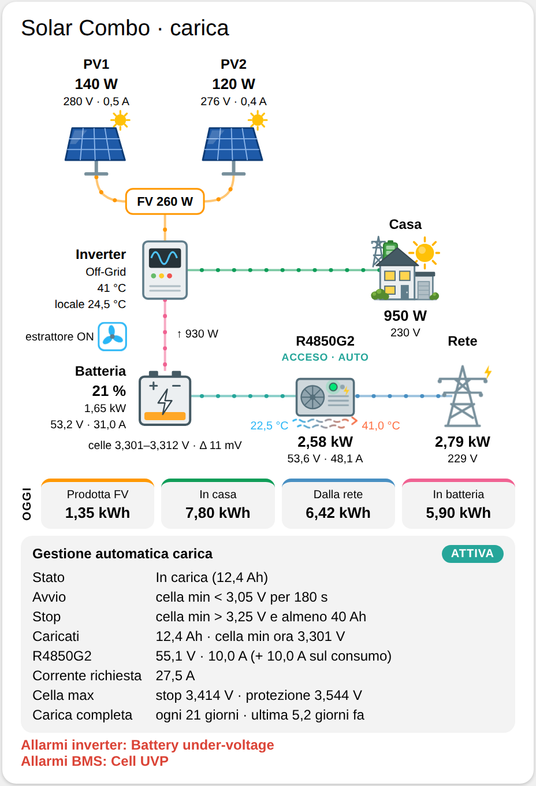
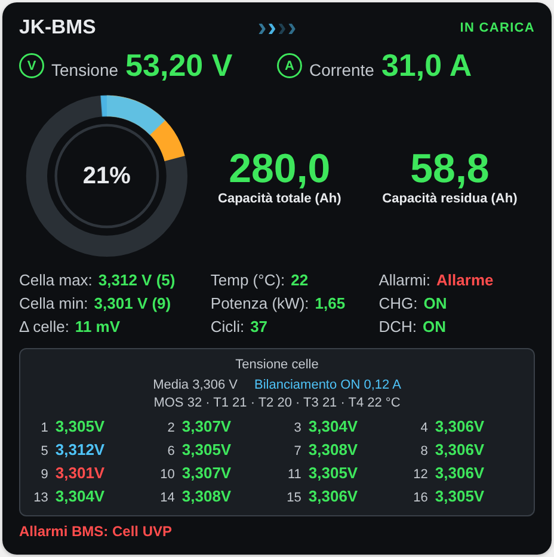
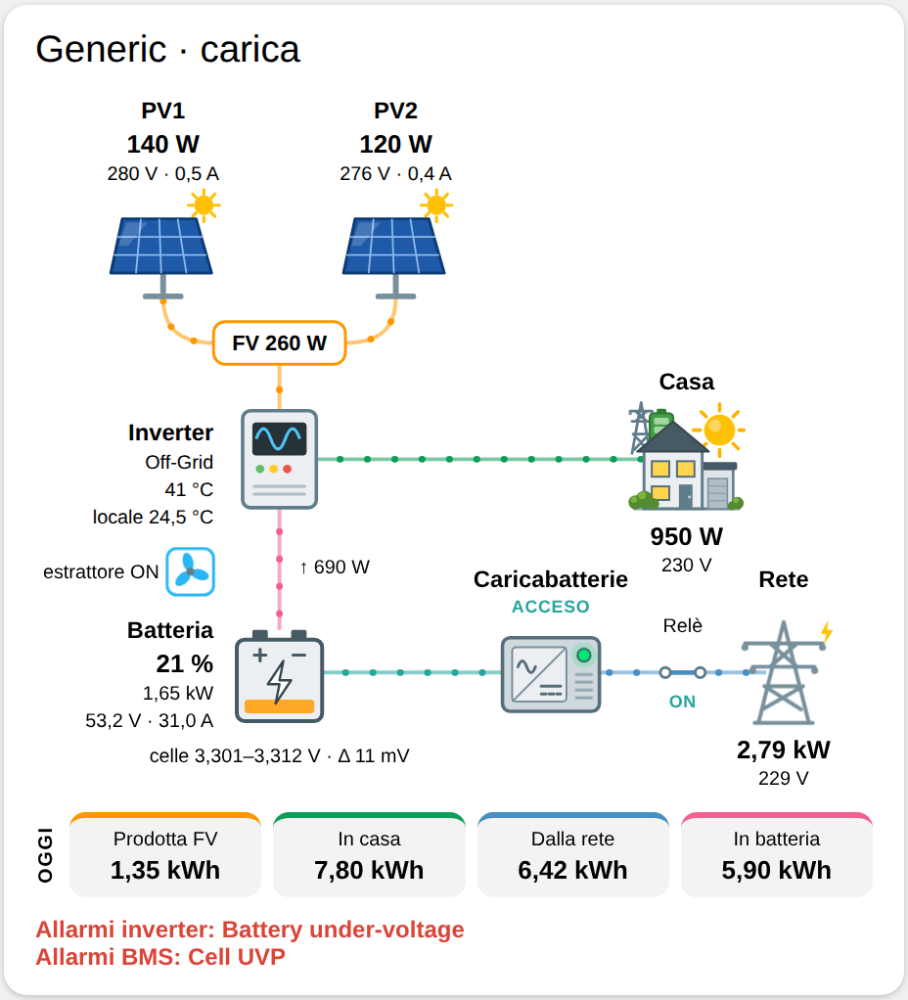

# Solar Combo Card

Card Lovelace per Home Assistant con il flusso di energia dell'impianto **solar-combo**:

- 2 stringhe fotovoltaiche (PV1, PV2) dell'inverter;
- inverter Easun SMG II, sempre in off-grid;
- batteria con JK-BMS;
- caricabatterie Huawei R4850G2;
- casa, cioè l'uscita AC dell'inverter;
- rete del gestore, che di norma entra solo nel R4850G2. Se è collegata anche all'ingresso AC dell'inverter, per esempio con il R4850G2 fuori uso, compare una seconda linea dal traliccio all'inverter.



> **Firmware.** Le card sono nate per *solar-combo*, un firmware ESPHome per questo impianto che **non è pubblico**; nel README ne compare anche una variante, *solar-offgrid-c3*, anch'essa non pubblica. Da quei firmware vengono soltanto gli entity_id predefiniti (`sensor.solar_combo_...`). Con qualsiasi altra integrazione basta indicare le proprie entità: vedi [Usare le card senza il firmware solar-combo](#usare-le-card-senza-il-firmware-solar-combo).

Nello stesso file ci sono anche la **[Solar Combo BMS Card](#solar-combo-bms-card)**, la card del pacco batterie con il JK-BMS, e la **[Solar Combo Generic Card](#solar-combo-generic-card)**, lo stesso schema con un caricabatterie generico acceso da un relè al posto del R4850G2.

Le novità di ogni versione, e perché conviene aggiornare, sono in [CHANGELOG.md](CHANGELOG.md).

Ogni elemento è un'illustrazione SVG disegnata nella card, senza file esterni. Alcuni dettagli seguono lo stato:

- il sole sul pannello quando la stringa produce;
- le finestre accese quando la casa consuma;
- dietro la casa, un sole quando la casa va a solare (le stringhe producono) e una batteria quando va a batteria (la batteria dà energia all'inverter); compaiono tutti e due quando il fotovoltaico copre solo una parte del consumo. Se la casa va a batteria mentre il R4850G2 carica dalla rete, accanto alla batteria compare anche un traliccio: l'energia arriva dalla rete attraverso il bus della batteria;
- il riempimento della batteria in base al SOC (rosso sotto il 20%, arancio sotto il 40%), con il fulmine quando è in carica;
- il LED verde, con un alone che pulsa, quando il R4850G2 è acceso;
- sotto il R4850G2, la corrente d'aria della ventola: entra a sinistra, fredda (azzurra), ed esce a destra, calda (arancio), con accanto la temperatura dell'aria in ingresso e quella in uscita. Quando il R4850G2 è acceso l'aria si muove, in standby resta ferma e sbiadita;
- la scintilla sul traliccio quando la rete fornisce energia;
- la linea traliccio → inverter, con la scritta «dalla rete …», solo quando all'ingresso AC dell'inverter ci sono almeno 100 V o arriva potenza. Allora sotto il traliccio c'è il totale preso dalla rete (R4850G2 + inverter) e, se la casa assorbe dalla rete attraverso l'inverter, dietro la casa compare il traliccio;
- sotto i testi dell'inverter, l'estrattore d'aria del locale con la scritta «estrattore ON/OFF»: le pale girano in azzurro quando è acceso, da spento è grigio e fermo. Compare solo se configuri la chiave `exhaust_fan` (vedi sotto), perché l'estrattore non è un'entità del firmware. Toccando il ventilatore si apre la sua finestra (da lì si accende e si spegne), toccando la scritta la finestra dei dettagli dell'estrattore.

| Flusso | Potenza mostrata |
|---|---|
| PV1, PV2 → totale FV | potenza di ogni stringa |
| totale FV → inverter | somma delle due stringhe, scritta nel riquadro tra i pannelli e l'inverter |
| inverter → casa | *SMG-II Output Active Power* |
| inverter ↔ batteria | *BMS Potenza* − *R4850G2 Output Power*: il R4850G2 carica la batteria direttamente sul bus DC, quindi la sua potenza va tolta dal totale del BMS. Freccia ↓ verso la batteria, ↑ verso l'inverter |
| rete → R4850G2 | *R4850G2 Input Power* |
| rete → inverter | *SMG-II Mains Power*, solo con l'ingresso AC dell'inverter collegato |
| R4850G2 → batteria | *R4850G2 Output Power* |

I puntini si muovono nel verso del flusso, più veloci quando la potenza è più alta. Sotto la soglia (`threshold`, 10 W se non la imposti) il flusso è fermo e gli indicatori sono spenti.

La velocità si regola con due opzioni. Un ciclo dell'animazione dura 1,5 s / (1 + W / `flow_scale`), ma mai meno di 1,5 s / `flow_max_speed`:

- `flow_scale` (fondo scala, in W, predefinito 500) è la potenza a cui i puntini vanno al doppio della velocità di partenza. Più è alto, più servono watt per accelerare.
- `flow_max_speed` (predefinito 6) è la velocità massima, come multiplo di quella di partenza: oltre questo valore i puntini non accelerano più.

| Potenza | `flow_scale: 500`, `flow_max_speed: 6` (predefiniti) | `flow_scale: 1500`, `flow_max_speed: 10` |
|---|---|---|
| 100 W | 1,25 s | 1,40 s |
| 1000 W | 0,50 s | 0,90 s |
| 3000 W | 0,25 s (massimo) | 0,50 s |
| 6000 W | 0,25 s | 0,30 s |

Sul R4850G2 c'è lo stato: STANDBY o ACCESO, più AUTO o MANUALE a seconda di *Gestione automatica carica*.

Sotto lo schema c'è la fascia **Oggi** con l'energia del giorno, in kWh, azzerata a mezzanotte:

- **Prodotta FV**: energia prodotta dalle due stringhe;
- **In casa**: energia erogata in casa dall'uscita AC dell'inverter;
- **Dalla rete**: energia prelevata dalla rete, dal R4850G2 e dall'ingresso AC dell'inverter;
- **In batteria**: energia immessa in batteria, dal FV e dal R4850G2 insieme.

I totali li calcola Home Assistant con il package [`packages/solar_combo_energia.yaml`](https://github.com/deltamike66/solar-combo-card/blob/main/packages/solar_combo_energia.yaml) di questo repository. Integra le potenze in kWh e ha gli `utility_meter` con ciclo giornaliero, che si azzerano a mezzanotte. Senza il package i riquadri non compaiono; `show_daily: false` nasconde la fascia.

Per installarlo:

1. Copia il file in `/config/packages/solar_combo_energia.yaml` (crea la cartella `packages` se non c'è). Il nome del file diventa il nome del package: solo minuscole, cifre e `_`.
2. Se non c'è già, aggiungi in `configuration.yaml`:

   ```yaml
   homeassistant:
     packages: !include_dir_named packages
   ```

3. Riavvia Home Assistant.

Il package legge le entità del dispositivo ESPHome `solar-combo` (`sensor.solar_combo_...`). Se il tuo dispositivo ha un altro nome, o non usi quel firmware, sostituisci le entità nel file (vedi [Fascia «Oggi» senza il package](#fascia-oggi-senza-il-package)).

Più in basso c'è il pannello **Gestione automatica carica**: se è attiva, lo stato e i parametri. Riporta le soglie di avvio e di stop sulla cella minima, la conferma, gli Ah minimi e quelli caricati, tensione e corrente del R4850G2 con il margine sul consumo, la corrente richiesta, le soglie di cella massima e la carica completa periodica. In fondo alla card ci sono i guasti e i warning dell'inverter (*Fault* e *Warning*, senza quelli nascosti dal firmware come «Mains not connected») e gli allarmi del BMS, se ce ne sono. Toccando un'illustrazione si apre la finestra dei dettagli della sua entità principale. Toccando un valore (potenze, tensioni, correnti, temperature, stati, il totale FV e le righe del pannello della carica) si apre la stessa finestra dei dettagli, sopra la plancia, con il grafico della sua entità: non si cambia pagina. I valori che ne combinano più di una, come «312 V · 6,9 A» o il totale FV, aprono quella principale (la prima: qui la tensione, per il totale FV la stringa PV1); le altre si raggiungono dalle loro voci.

## Installazione

La card è un solo file JavaScript, senza dipendenze e senza compilazione: `dist/solar-combo-card.js`. Lo stesso file contiene anche la Solar Combo BMS Card: installandolo si hanno tutte e due.

### Con HACS

1. Apri **HACS**, menu **⋮** in alto a destra → **Archivi digitali personalizzati**.
2. In **Archivio digitale** incolla `https://github.com/deltamike66/solar-combo-card`, come **Tipo** scegli **Dashboard** e premi **Aggiungi**.
3. Cerca **Solar Combo Card** in HACS, aprila e premi **Scarica**: la risorsa viene aggiunta da sola.
4. Ricarica la pagina del browser.

Gli aggiornamenti compaiono in HACS a ogni nuova release del repository.

### A mano

1. Copia `dist/solar-combo-card.js` in `/config/www/solar-combo-card.js` (crea la cartella `www` se non c'è; dopo averla creata riavvia Home Assistant).
2. Dichiara la risorsa in `configuration.yaml` e riavvia Home Assistant:

   ```yaml
   lovelace:
     resource_mode: yaml
     resources:
       - url: /local/solar-combo-card.js
         type: module
   ```

   Senza `resource_mode: yaml` la lista `resources:` viene ignorata. Con `resource_mode: yaml` **tutte** le risorse si leggono da questa lista: se ne avevi già altre (per esempio card installate con HACS), vanno elencate anche loro.
   Nelle versioni con la Modalità avanzata (fino alla 2026.5) c'era anche la pagina **Impostazioni → Dashboard → ⋮ → Risorse → Aggiungi risorsa** (URL `/local/solar-combo-card.js`, tipo **Modulo JavaScript**), visibile solo con la Modalità avanzata attiva nel profilo.
3. Ricarica la pagina del browser. Dopo un aggiornamento del file, svuota la cache o aggiungi la versione all'URL della risorsa (per esempio `/local/solar-combo-card.js?v=0.14.0`).

## Configurazione

```yaml
type: custom:solar-combo-card
title: Solar Combo          # facoltativo
prefix: solar_combo         # facoltativo: prefisso degli entity_id
inverter: smg_ii            # facoltativo: nome dell'inverter nelle sue entità
show_daily: true            # facoltativo: false nasconde la fascia dell'energia del giorno
show_charge: true           # facoltativo: false nasconde il pannello della gestione carica
threshold: 10               # facoltativo: soglia in W sotto cui flussi e indicatori sono spenti
flow_scale: 500             # facoltativo: fondo scala della velocità dei flussi, in W
flow_max_speed: 6           # facoltativo: velocità massima dei flussi (multiplo di quella di partenza)
entities:                   # facoltativo: sostituisce le singole entità
  load_power: sensor.solar_combo_smg_ii_output_active_power
  exhaust_fan: switch.locale_inverter_estrattore_d_aria   # facoltativo: estrattore d'aria del locale
```

Gli entity_id predefiniti sono quelli che Home Assistant crea per il dispositivo ESPHome `solar-combo`.

> **Non usi il firmware solar-combo?** Le card funzionano con entità di qualsiasi integrazione (altri firmware ESPHome, Solarman, integrazioni dell'inverter o del BMS, sensori template...). Vedi **[Usare le card senza il firmware solar-combo](#usare-le-card-senza-il-firmware-solar-combo)**: che entità servono, con quali unità e segni, ed esempi completi.

- Se hai rinominato il dispositivo, cambia `prefix`.
- Le entità dell'inverter contengono il suo nome (`inv_name: SMG-II` nel firmware, quindi `smg_ii`). Se cambi inverter e quindi `inv_name`, basta impostare `inverter` con il nuovo nome in minuscolo, con `_` al posto di spazi e trattini.
- Se hai rinominato una sola entità, mettila sotto `entities`.

| Chiave | Entità predefinita (`{p}` = prefisso, `{inv}` = inverter) |
|---|---|
| `pv1_power`, `pv1_voltage`, `pv1_current` | `sensor.{p}_{inv}_pv1_power`, `_voltage`, `_current` |
| `pv2_power`, `pv2_voltage`, `pv2_current` | `sensor.{p}_{inv}_pv2_power`, `_voltage`, `_current` |
| `inverter_mode` | `sensor.{p}_{inv}_operation_mode` |
| `inverter_temp` | `sensor.{p}_{inv}_temperature` |
| `room_temp` | `sensor.{p}_temperatura_locale_inverter` (sonda DS18B20 del locale) |
| `load_power` | `sensor.{p}_{inv}_output_active_power` |
| `load_voltage` | `sensor.{p}_{inv}_output_effective_voltage` |
| `battery_soc` | `sensor.{p}_bms_state_of_charge` |
| `battery_power` | `sensor.{p}_bms_potenza` (positiva in carica) |
| `battery_voltage`, `battery_current` | `sensor.{p}_bms_tensione_totale`, `sensor.{p}_bms_corrente` |
| `cell_min`, `cell_max`, `cell_delta` | `sensor.{p}_bms_cella_minima`, `_cella_massima`, `_delta_celle` |
| `bms_alarms` | `sensor.{p}_bms_allarmi` |
| `inverter_fault`, `inverter_warning` | `sensor.{p}_{inv}_fault`, `_warning` |
| `charger_power`, `charger_voltage`, `charger_current` | `sensor.{p}_r4850g2_output_power`, `_output_voltage`, `_output_current` |
| `charger_standby` | `switch.{p}_r4850g2_standby` |
| `charge_auto` | `switch.{p}_gestione_automatica_carica` |
| `charge_state` | `sensor.{p}_stato_gestione_carica` |
| `grid_power`, `grid_voltage` | `sensor.{p}_r4850g2_input_power`, `_input_voltage` |
| `inverter_grid_power`, `inverter_grid_voltage` | `sensor.{p}_{inv}_mains_power`, `_ac_mains_voltage` (rete all'ingresso AC dell'inverter) |
| `charger_temp_in`, `charger_temp_out` | `sensor.{p}_r4850g2_input_temperature`, `_output_temperature` (aria in ingresso e in uscita) |
| `charge_start`, `charge_stop` | `number.{p}_carica_avvio_sotto_cella_min`, `_carica_stop_sopra_cella_min` |
| `charge_confirm`, `charge_min_ah` | `number.{p}_carica_conferma_avvio`, `_carica_ah_minimi` |
| `charge_voltage`, `charge_current`, `charge_margin` | `number.{p}_carica_tensione_r4850g2`, `_carica_corrente_r4850g2`, `_carica_margine_sul_consumo` |
| `full_charge_days` | `number.{p}_carica_completa_ogni_giorni` |
| `charged_ah`, `charge_current_req` | `sensor.{p}_carica_ah_caricati`, `_carica_corrente_richiesta` |
| `cell_max_charge`, `cell_max_protection` | `sensor.{p}_soglia_cella_max_carica`, `_soglia_cella_max_protezione` |
| `days_since_full` | `sensor.{p}_giorni_dall_ultima_carica_completa` |
| `energy_pv`, `energy_load` | `sensor.{p}_fv_giorno`, `_casa_giorno` (kWh del giorno, dal package `solar_combo_energia.yaml`) |
| `energy_grid`, `energy_battery_in` | `sensor.{p}_rete_giorno`, `_batteria_carica_giorno` |
| `inverter_battery_power` | nessuna: se la imposti (positiva verso la batteria) sostituisce il calcolo *BMS Potenza* − *R4850G2 Output Power* |
| `exhaust_fan` | nessuna: estrattore d'aria del locale inverter, un `switch` o un `fan` di Home Assistant (acceso = stato `on`). Senza questa chiave il ventilatore non compare |

Il SOC mostrato è quello del BMS, poco affidabile d'inverno: la logica di carica della centralina non lo usa.

## Solar Combo BMS Card

Card del pacco batterie con il JK-BMS (`type: custom:solar-combo-bms-card`). Riprende lo stile del display del BMS: schermo scuro e valori in verde.



- **In alto**: tensione e corrente del pacco, con le frecce e la scritta del verso: IN CARICA (frecce azzurre verso destra), IN SCARICA (frecce arancio verso sinistra) o A RIPOSO (frecce spente).
- **Al centro**: l'anello del SOC, verde, arancio sotto il 40% e rosso sotto il 20%. In carica ci gira sopra un tratto azzurro, in scarica uno arancio nel verso opposto. Accanto ci sono la capacità totale e quella residua in Ah.
- **Sotto**: cella massima e minima, con tra parentesi il numero della cella, poi Δ celle, la temperatura più alta delle sonde della batteria, la potenza in kW e i cicli. Ci sono anche gli allarmi («Nessuno» in verde, «Allarme» in rosso) e lo stato dei MOS di carica (CHG) e di scarica (DCH): ON in verde, OFF in rosso.
- **Tensione celle**: la griglia con la tensione di ogni cella, con la più alta in azzurro e la più bassa in rosso. Sopra la griglia ci sono la media, il bilanciamento (ON in azzurro, con la corrente) e tutte le temperature: MOS e sonde T1–T4.
- **In fondo**: il testo degli allarmi del BMS, se ce ne sono.

Toccando l'anello si apre la finestra dei dettagli del SOC. Toccando un valore o una cella si apre la finestra dei dettagli della sua entità (per i valori che ne combinano più di una, quella principale), senza cambiare pagina. Le voci con entità che non esistono vengono nascoste: per esempio il firmware solar-offgrid-c3 non ha capacità totale, stato dei MOS, bilanciamento e sonde T3–T4.

```yaml
type: custom:solar-combo-bms-card
title: JK-BMS               # facoltativo: testo in alto a sinistra ("" per nasconderlo)
prefix: solar_combo         # facoltativo: prefisso degli entity_id (solar_offgrid per il solar-offgrid-c3)
cells: 16                   # facoltativo: numero di celle; se manca si legge "BMS Numero Celle", altrimenti 16
cell_columns: 4             # facoltativo: colonne della griglia delle celle (1-8)
show_cells: true            # facoltativo: false nasconde la griglia delle celle
threshold: 0.5              # facoltativo: corrente in A sotto cui la batteria è "a riposo"
entities:                   # facoltativo: sostituisce le singole entità
  soc: sensor.solar_combo_bms_state_of_charge
  cell_1: sensor.solar_combo_bms_cella_1
```

| Chiave | Entità predefinita (`{p}` = prefisso) |
|---|---|
| `soc` | `sensor.{p}_bms_state_of_charge` |
| `voltage`, `current`, `power` | `sensor.{p}_bms_tensione_totale`, `_bms_corrente`, `_bms_potenza` |
| `capacity_total`, `capacity_remaining` | `sensor.{p}_bms_capacita_totale`, `_bms_capacita_residua` |
| `cell_min`, `cell_max`, `cell_avg`, `cell_delta` | `sensor.{p}_bms_cella_minima`, `_cella_massima`, `_media_celle`, `_delta_celle` |
| `temp_mos`, `temp_1` … `temp_4` | `sensor.{p}_bms_temperatura_mos`, `_temperatura_1` … `_temperatura_4` |
| `balancing`, `balancing_current` | `binary_sensor.{p}_bms_bilanciamento_attivo`, `sensor.{p}_bms_corrente_bilanciamento` |
| `charge_mos`, `discharge_mos` | `binary_sensor.{p}_bms_mos_carica_attivo`, `_bms_mos_scarica_attivo` |
| `cycles` | `sensor.{p}_bms_cicli_di_carica` |
| `alarms` | `sensor.{p}_bms_allarmi` |
| `cell_count` | `number.{p}_bms_numero_celle` |
| `cell_1` … `cell_32` | `sensor.{p}_bms_cella_1` … `_cella_32` (fino al numero di celle) |

Il nome dell'elemento non è `jk-bms-card`: quel nome è già usato da un'altra card di HACS, e le due si potrebbero installare insieme.

## Solar Combo Generic Card

Lo schema della Solar Combo Card senza il R4850G2 (`type: custom:solar-combo-generic-card`). Al suo posto c'è un **caricabatterie generico**, acceso e spento da un **relè**. Serve quando la batteria si carica dalla rete con un caricabatterie qualsiasi, comandato da un relè o da una presa smart.



- **Relè**: è disegnato come un contatto sulla linea tra la rete e il caricabatterie. Quando il relè è acceso il contatto è chiuso (azzurro, ON) e i flussi rete → caricabatterie → batteria si muovono. Quando è spento il contatto è aperto (grigio, OFF). Toccando il relè o il caricabatterie si apre la finestra del relè, da cui lo puoi accendere e spegnere.
- **Caricabatterie**: la scritta ACCESO/SPENTO segue il relè e il LED si accende con il relè. Potenza, tensione e corrente compaiono solo se configuri le loro entità.
- **Senza misure**: con il solo relè, quando è acceso i flussi si muovono alla velocità minima e la potenza non si scrive. La potenza tra inverter e batteria si stima come FV − casa.
- Tutto il resto è come nella Solar Combo Card: stringhe FV, inverter, batteria, casa, estrattore d'aria (`exhaust_fan`), fascia «Oggi» e allarmi. Non c'è il pannello della gestione carica e non ci sono le temperature dell'aria, che sono del R4850G2.

Le entità del caricabatterie non sono del firmware, quindi vanno indicate sotto `entities`: `charger_relay` serve sempre, le altre sono facoltative.

```yaml
type: custom:solar-combo-generic-card
title: Solar Combo          # facoltativo
prefix: solar_combo         # facoltativo: prefisso degli entity_id (solar_offgrid per il solar-offgrid-c3)
entities:
  charger_relay: switch.rele_caricabatterie           # relè del caricabatterie (switch, o light/fan/input_boolean)
  grid_power: sensor.presa_caricabatterie_potenza     # facoltativo: potenza presa dalla rete (W)
  grid_voltage: sensor.presa_caricabatterie_tensione  # facoltativo: tensione di rete (V)
  charger_power: sensor.caricabatterie_potenza        # facoltativo: potenza data alla batteria (W)
  charger_voltage: sensor.caricabatterie_tensione     # facoltativo
  charger_current: sensor.caricabatterie_corrente     # facoltativo
  exhaust_fan: switch.locale_inverter_estrattore_d_aria  # facoltativo
```

| Chiave | Uso |
|---|---|
| `charger_relay` | relè del caricabatterie: acceso = stato `on`. Nessuna entità predefinita |
| `charger_power` | potenza che il caricabatterie dà alla batteria. Se manca ma ci sono `charger_voltage` e `charger_current`, si calcola tensione × corrente; si toglie da *BMS Potenza* per avere il flusso inverter ↔ batteria |
| `charger_voltage`, `charger_current` | tensione e corrente d'uscita del caricabatterie, scritte sotto la potenza |
| `grid_power`, `grid_voltage` | potenza e tensione della rete, sotto il traliccio (per esempio da una presa smart con misura) |
| le altre | come nella Solar Combo Card (`prefix`, `inverter`, `threshold`, `flow_scale`, `flow_max_speed`, `show_daily` e le entità di FV, inverter, batteria, casa ed energia del giorno) |

## Usare le card senza il firmware solar-combo

Le tre card leggono semplicemente degli stati di Home Assistant: non importa da quale integrazione arrivano. Non avendo il firmware solar-combo, che non è pubblico, indica tu sotto `entities` l'entity_id di ogni dato. Le chiavi che non indichi restano su quelle predefinite del firmware (`sensor.solar_combo_...`) e, se nel tuo Home Assistant non esistono, la card le tratta come mancanti.

### Trovare gli entity_id

- **Impostazioni → Dispositivi e servizi → Entità**: cerca per nome e apri l'entità; l'entity_id è in **⚙ Impostazioni → ID entità**.
- **Strumenti per sviluppatori → Stati**: mostra per ogni entità lo stato attuale e gli attributi, compresa `unit_of_measurement`. Qui controlli subito unità e segno (per esempio se la potenza della batteria è positiva o negativa mentre carica).

### Regole che valgono per tutte le card

1. **Unità fisse, nessuna conversione.** La card prende il numero dello stato così com'è e **non guarda `unit_of_measurement`**. Un sensore in kW verrebbe letto come W (1,2 kW diventa 1,2 W). Le unità attese sono:

   | Grandezza | Unità |
   |---|---|
   | potenze | **W** |
   | tensioni (anche delle celle) | **V** |
   | Δ celle | **mV** |
   | correnti | **A** |
   | temperature | **°C** |
   | SOC | **%** (0–100) |
   | energia del giorno | **kWh** |
   | capacità | **Ah** |

   Se la tua integrazione usa un'altra unità, crea un sensore template che converte (vedi [sotto](#sensori-template-per-convertire-unità-e-segni)).

2. **Segni.**

   | Chiave | Positivo quando… |
   |---|---|
   | `battery_power` (Solar Combo / Generic), `power` e `current` (BMS Card) | la batteria **si carica** (negativo in scarica) |
   | `inverter_battery_power` | l'energia va **dall'inverter alla batteria** |
   | `load_power`, `pv1_power`, `pv2_power`, `grid_power`, `inverter_grid_power`, `charger_power` | sempre positivo nel verso normale (dalla sorgente verso il carico) |

   Se la tua batteria è negativa in carica, inverti il segno con un template.

3. **Stati on/off.** Interruttori e sensori binari valgono `on`/`off`: vanno bene `switch`, `binary_sensor`, `input_boolean`, `light`, `fan`. Attenzione a `charger_standby`: **`on` vuol dire caricabatterie in standby** (spento), `off` vuol dire acceso.
4. **Testi.** `inverter_mode` e `charge_state` si mostrano così come sono, qualunque testo sia. Per `inverter_fault`, `inverter_warning`, `bms_alarms` e `alarms` un testo vuoto, `unknown` o `unavailable` vuol dire «nessun allarme»; qualsiasi altro testo viene mostrato come allarme.
5. **Entità mancanti.** Se una chiave punta a un'entità che non esiste, al posto del valore compare «—» e il flusso relativo resta fermo; la card non dà errori. Per dire esplicitamente che un dato non c'è scrivi `null`: per esempio `inverter_grid_power: null` toglie la linea rete → inverter. Alcune parti spariscono da sole se mancano le loro entità: la fascia «Oggi», l'estrattore (`exhaust_fan`) e, nella BMS Card, capacità, MOS, bilanciamento, sonde di temperatura, media celle e le altre voci della parte bassa.

### Solar Combo Card: cosa serve per ogni chiave

Per uno schema che funziona bastano le chiavi **indispensabili**; le altre aggiungono testi e dettagli.

| Chiave | Tipo di entità | Unità | Note |
|---|---|---|---|
| `pv1_power`, `pv2_power` | sensor | W | **indispensabili** (con una sola stringa, `pv2_power: null`: PV2 mostra «—») |
| `pv1_voltage`, `pv1_current`, `pv2_voltage`, `pv2_current` | sensor | V, A | testo sotto ogni stringa |
| `load_power` | sensor | W | **indispensabile**: potenza erogata in casa dall'inverter |
| `load_voltage` | sensor | V | tensione d'uscita |
| `battery_power` | sensor | W | **indispensabile**, positiva in carica |
| `battery_soc` | sensor | % | riempimento della batteria |
| `battery_voltage`, `battery_current` | sensor | V, A | |
| `cell_min`, `cell_max` | sensor | V | tensione della cella più bassa e più alta |
| `cell_delta` | sensor | **mV** | |
| `inverter_mode` | sensor (testo) | — | stato dell'inverter, mostrato com'è |
| `inverter_temp`, `room_temp` | sensor | °C | temperatura dell'inverter e del locale |
| `inverter_fault`, `inverter_warning`, `bms_alarms` | sensor (testo) | — | in fondo alla card; vuoto = nessuno |
| `charger_power` | sensor | W | potenza data alla batteria dal caricabatterie; se manca si calcola tensione × corrente |
| `charger_voltage`, `charger_current` | sensor | V, A | uscita del caricabatterie |
| `charger_standby` | switch / binary_sensor | — | **`on` = standby**, `off` = acceso (LED verde, aria che si muove) |
| `charger_temp_in`, `charger_temp_out` | sensor | °C | aria in ingresso e in uscita del caricabatterie |
| `grid_power`, `grid_voltage` | sensor | W, V | rete che entra nel caricabatterie |
| `inverter_grid_power`, `inverter_grid_voltage` | sensor | W, V | rete all'ingresso AC dell'inverter; `null` se non c'è |
| `inverter_battery_power` | sensor | W | facoltativa, positiva verso la batteria: sostituisce il calcolo `battery_power` − `charger_power` |
| `energy_pv`, `energy_load`, `energy_grid`, `energy_battery_in` | sensor | kWh | fascia «Oggi», vedi [sotto](#fascia-oggi-senza-il-package) |
| `exhaust_fan` | switch / fan | — | estrattore del locale, facoltativo |
| `charge_auto`, `charge_state` e le altre chiavi `charge_*`, `charged_ah`, `cell_max_*`, `days_since_full`, `full_charge_days` | — | — | logica di carica del firmware solar-combo: senza quel firmware metti `show_charge: false` |

**Come si calcola il flusso inverter ↔ batteria.** Se c'è `inverter_battery_power` si usa quella. Altrimenti è `battery_power` − `charger_power`: il caricabatterie carica la batteria direttamente sul bus DC, quindi la sua parte non passa dall'inverter. Senza caricabatterie (`charger_power` mancante) è semplicemente `battery_power`.

Esempio con entità di un'altra integrazione (inverter con una sola stringa, nessun caricabatterie esterno):

```yaml
type: custom:solar-combo-card
title: Impianto
show_charge: false            # niente logica di carica del firmware solar-combo
show_daily: false             # oppure indica le quattro energy_* (vedi sotto)
entities:
  pv1_power: sensor.inverter_pv_power
  pv1_voltage: sensor.inverter_pv_voltage
  pv1_current: sensor.inverter_pv_current
  pv2_power: null
  pv2_voltage: null
  pv2_current: null
  inverter_mode: sensor.inverter_device_mode
  inverter_temp: sensor.inverter_temperature
  room_temp: null
  load_power: sensor.inverter_load_power
  load_voltage: sensor.inverter_output_voltage
  battery_soc: sensor.batteria_soc
  battery_power: sensor.batteria_potenza            # W, positiva in carica
  battery_voltage: sensor.batteria_tensione
  battery_current: sensor.batteria_corrente
  cell_min: sensor.batteria_cella_min
  cell_max: sensor.batteria_cella_max
  cell_delta: sensor.batteria_delta_celle_mv        # mV
  inverter_fault: sensor.inverter_fault
  inverter_warning: sensor.inverter_warning
  bms_alarms: sensor.batteria_allarmi
  # nessun caricabatterie: tutte le chiavi del caricabatterie a null
  charger_power: null
  charger_voltage: null
  charger_current: null
  charger_standby: null
  charger_temp_in: null
  charger_temp_out: null
  grid_power: null
  grid_voltage: null
  # rete collegata all'ingresso AC dell'inverter
  inverter_grid_power: sensor.inverter_grid_power
  inverter_grid_voltage: sensor.inverter_grid_voltage
```

Senza caricabatterie esterno lo schema mostra comunque il nodo «R4850G2», con «—» e i flussi fermi. Se invece carichi la batteria dalla rete con un caricabatterie qualsiasi comandato da un relè o da una presa smart, usa la **[Solar Combo Generic Card](#solar-combo-generic-card)**.

### Solar Combo Generic Card: cosa serve

Le stesse chiavi della Solar Combo Card per FV, inverter, batteria, casa, rete all'ingresso dell'inverter, energia del giorno ed estrattore, più quelle del caricabatterie generico:

| Chiave | Tipo di entità | Unità | Note |
|---|---|---|---|
| `charger_relay` | switch / light / fan / input_boolean | — | **indispensabile**: `on` = caricabatterie acceso |
| `charger_power` | sensor | W | potenza data alla batteria; se manca, tensione × corrente |
| `charger_voltage`, `charger_current` | sensor | V, A | |
| `grid_power`, `grid_voltage` | sensor | W, V | rete che entra nel caricabatterie, per esempio da una presa smart con misura |

Non ci sono le chiavi `charger_standby`, `charger_temp_*`, `charge_*` e il pannello della carica. Senza nessuna misura della potenza del caricabatterie, il flusso inverter ↔ batteria si stima come FV − casa.

### Solar Combo BMS Card: cosa serve per ogni chiave

Funziona con qualsiasi BMS (JK, Daly, JBD, Seplos, Pylontech...), purché i valori arrivino in Home Assistant come entità separate.

| Chiave | Tipo di entità | Unità | Note |
|---|---|---|---|
| `soc` | sensor | % | **indispensabile**: l'anello |
| `voltage`, `current` | sensor | V, A | **indispensabili**; la corrente è **positiva in carica** e decide IN CARICA / IN SCARICA / A RIPOSO (soglia `threshold`, 0,5 A) |
| `power` | sensor | **W** | positiva in carica; la card la mostra in kW |
| `cell_1` … `cell_32` | sensor | V | tensione di ogni cella; la griglia mostra le prime `cells` |
| `cell_min`, `cell_max`, `cell_avg` | sensor | V | il numero della cella min/max lo trova la card dalla griglia |
| `cell_delta` | sensor | **mV** | |
| `capacity_total`, `capacity_remaining` | sensor | Ah | se mancano spariscono |
| `temp_mos`, `temp_1` … `temp_4` | sensor | °C | quelle che mancano non compaiono |
| `balancing` | binary_sensor / switch | — | `on` = bilanciamento in corso |
| `balancing_current` | sensor | A | |
| `charge_mos`, `discharge_mos` | binary_sensor / switch | — | `on` = MOS chiuso (ON in verde) |
| `cycles` | sensor | — | cicli di carica |
| `alarms` | sensor (testo) | — | vuoto = nessun allarme |
| `cell_count` | sensor / number | — | numero di celle, se non imposti `cells` |

Con un BMS diverso conviene impostare sempre `cells`: senza `cells` e senza `cell_count` la card mostra 16 celle.

```yaml
type: custom:solar-combo-bms-card
title: Batteria
cells: 8
cell_columns: 4
entities:
  soc: sensor.bms_soc
  voltage: sensor.bms_voltage
  current: sensor.bms_current          # A, positiva in carica
  power: sensor.bms_power              # W, positiva in carica
  capacity_total: sensor.bms_capacity
  capacity_remaining: sensor.bms_remaining_capacity
  cell_min: sensor.bms_min_cell_voltage
  cell_max: sensor.bms_max_cell_voltage
  cell_avg: sensor.bms_average_cell_voltage
  cell_delta: sensor.bms_delta_mv      # mV
  temp_mos: sensor.bms_mos_temperature
  temp_1: sensor.bms_temperature_1
  temp_2: sensor.bms_temperature_2
  temp_3: null
  temp_4: null
  balancing: binary_sensor.bms_balancing
  balancing_current: sensor.bms_balancing_current
  charge_mos: binary_sensor.bms_charging
  discharge_mos: binary_sensor.bms_discharging
  cycles: sensor.bms_cycles
  alarms: sensor.bms_errors
  cell_1: sensor.bms_cell_voltage_1
  cell_2: sensor.bms_cell_voltage_2
  cell_3: sensor.bms_cell_voltage_3
  cell_4: sensor.bms_cell_voltage_4
  cell_5: sensor.bms_cell_voltage_5
  cell_6: sensor.bms_cell_voltage_6
  cell_7: sensor.bms_cell_voltage_7
  cell_8: sensor.bms_cell_voltage_8
```

Se il tuo dispositivo ESPHome segue lo stesso schema di nomi del firmware solar-combo (`sensor.<dispositivo>_bms_cella_1` ...), basta `prefix: <dispositivo>` senza elencare le entità.

### Sensori template per convertire unità e segni

Si creano in `configuration.yaml` (o in un package) e poi si indicano nella card al posto dell'entità originale. Oppure dall'interfaccia: **Impostazioni → Dispositivi e servizi → Aiutanti → Crea aiutante → Template → Sensore**.

```yaml
template:
  - sensor:
      # kW -> W
      - name: "Batteria potenza W"
        unique_id: batteria_potenza_w
        unit_of_measurement: "W"
        device_class: power
        state_class: measurement
        availability: "{{ has_value('sensor.batteria_potenza_kw') }}"
        state: "{{ (states('sensor.batteria_potenza_kw') | float * 1000) | round(0) }}"

      # segno invertito: la tua batteria è negativa in carica
      - name: "Batteria potenza carica positiva"
        unique_id: batteria_potenza_carica_positiva
        unit_of_measurement: "W"
        device_class: power
        state_class: measurement
        availability: "{{ has_value('sensor.batteria_potenza') }}"
        state: "{{ 0 - states('sensor.batteria_potenza') | float }}"

      # Δ celle in V -> mV
      - name: "Batteria delta celle mV"
        unique_id: batteria_delta_celle_mv
        unit_of_measurement: "mV"
        state_class: measurement
        availability: "{{ has_value('sensor.batteria_delta_celle') }}"
        state: "{{ (states('sensor.batteria_delta_celle') | float * 1000) | round(0) }}"

      # potenza della batteria da tensione × corrente, se l'integrazione non la dà
      - name: "Batteria potenza calcolata"
        unique_id: batteria_potenza_calcolata
        unit_of_measurement: "W"
        device_class: power
        state_class: measurement
        availability: "{{ has_value('sensor.batteria_tensione') and has_value('sensor.batteria_corrente') }}"
        state: "{{ (states('sensor.batteria_tensione') | float * states('sensor.batteria_corrente') | float) | round(0) }}"
```

Allo stesso modo si ottengono `cell_min`, `cell_max` e `cell_delta` dalle singole celle, se il BMS non li fornisce:

```yaml
template:
  - sensor:
      - name: "Batteria cella min"
        unique_id: batteria_cella_min
        unit_of_measurement: "V"
        device_class: voltage
        state_class: measurement
        state: >-
          {{ expand('sensor.bms_cell_voltage_1', 'sensor.bms_cell_voltage_2',
                    'sensor.bms_cell_voltage_3', 'sensor.bms_cell_voltage_4')
             | map(attribute='state') | map('float', none) | reject('none') | min }}
```

(per la massima `max` al posto di `min`; per il Δ in mV la differenza fra le due × 1000).

### Fascia «Oggi» senza il package

La fascia legge quattro sensori di **energia del giorno in kWh, che si azzerano a mezzanotte**: `energy_pv`, `energy_load`, `energy_grid`, `energy_battery_in`. Ogni riquadro compare solo se la sua entità esiste.

- Se la tua integrazione ha già contatori giornalieri (molti inverter danno «produzione di oggi», «consumo di oggi»...), indicali direttamente sotto `entities`, controllando che siano in kWh.
- Altrimenti prendi come modello il package [`packages/solar_combo_energia.yaml`](https://github.com/deltamike66/solar-combo-card/blob/main/packages/solar_combo_energia.yaml) di questo repository: un sensore `integration` trasforma la potenza (W) in energia (kWh), un `utility_meter` con `cycle: daily` la azzera ogni giorno. Basta sostituire le entità `sensor.solar_combo_...` con le tue e cambiare nomi e `unique_id`.

```yaml
sensor:
  - platform: integration
    name: "Energia FV"
    unique_id: energia_fv
    source: sensor.inverter_pv_power     # W
    unit_prefix: k
    unit_time: h
    method: left
    round: 3
    max_sub_interval: {minutes: 1}

utility_meter:
  fv_giorno:
    name: "FV giorno"
    unique_id: fv_giorno
    source: sensor.energia_fv
    cycle: daily
```

e nella card `energy_pv: sensor.fv_giorno`. Per «In batteria» integra solo la parte positiva della potenza della batteria (un template con `max(potenza, 0)`, come nel package).
