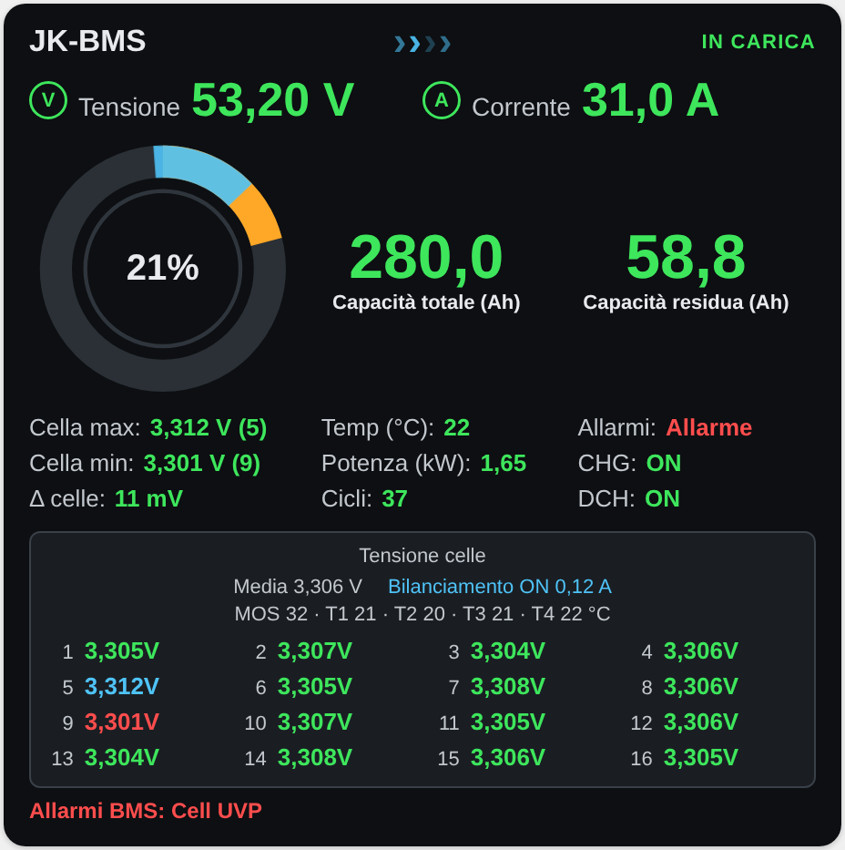

# Solar Combo Card

Card Lovelace per Home Assistant con il flusso di energia dell'impianto **solar-combo** (firmware `esphome/solar-combo.yaml`):

- 2 stringhe fotovoltaiche (PV1, PV2) dell'inverter;
- inverter Easun SMG II, sempre in off-grid;
- batteria con JK-BMS;
- caricabatterie Huawei R4850G2;
- casa, cioè l'uscita AC dell'inverter;
- rete del gestore, che entra **solo** nel R4850G2.


Nello stesso file c'è anche la **[Solar Combo BMS Card](#solar-combo-bms-card)**, la card del pacco batterie con il JK-BMS.

Le novità di ogni versione, e perché conviene aggiornare, sono in [CHANGELOG.md](CHANGELOG.md).

Ogni elemento è un'illustrazione SVG disegnata nella card, senza file esterni. Alcuni dettagli seguono lo stato:

- il sole sul pannello quando la stringa produce;
- le finestre accese quando la casa consuma;
- dietro la casa, un sole quando la casa va a solare (le stringhe producono) e una batteria quando va a batteria (la batteria dà energia all'inverter); compaiono tutti e due quando il fotovoltaico copre solo una parte del consumo. Se la casa va a batteria mentre il R4850G2 carica dalla rete, accanto alla batteria compare anche un traliccio: l'energia arriva dalla rete attraverso il bus della batteria;
- il riempimento della batteria in base al SOC (rosso sotto il 20%, arancio sotto il 40%), con il fulmine quando è in carica;
- il LED verde, con un alone che pulsa, quando il R4850G2 è acceso;
- sotto il R4850G2, la corrente d'aria della ventola: entra a sinistra, fredda (azzurra), ed esce a destra, calda (arancio), con accanto la temperatura dell'aria in ingresso e quella in uscita. Quando il R4850G2 è acceso l'aria si muove, in standby resta ferma e sbiadita;
- la scintilla sul traliccio quando la rete fornisce energia;
- sotto i testi dell'inverter, l'estrattore d'aria del locale con la scritta «estrattore ON/OFF»: le pale girano in azzurro quando è acceso, da spento è grigio e fermo. Compare solo se configuri la chiave `exhaust_fan` (vedi sotto), perché l'estrattore non è un'entità del firmware. Toccando il ventilatore si apre la sua finestra (da lì si accende e si spegne), toccando la scritta la Cronologia.

| Flusso | Potenza mostrata |
|---|---|
| PV1, PV2 → totale FV | potenza di ogni stringa |
| totale FV → inverter | somma delle due stringhe, scritta nel riquadro tra i pannelli e l'inverter |
| inverter → casa | *SMG-II Output Active Power* |
| inverter ↔ batteria | *BMS Potenza* − *R4850G2 Output Power*: il R4850G2 carica la batteria direttamente sul bus DC, quindi la sua potenza va tolta dal totale del BMS. Freccia ↓ verso la batteria, ↑ verso l'inverter |
| rete → R4850G2 | *R4850G2 Input Power* |
| R4850G2 → batteria | *R4850G2 Output Power* |

I puntini si muovono nel verso del flusso, più veloci quando la potenza è più alta. Sotto la soglia (`threshold`, 10 W se non la imposti) il flusso è fermo e gli indicatori sono spenti.

La velocità si regola con due opzioni. Un ciclo dell'animazione dura 1,5 s / (1 + W / `flow_scale`), ma mai meno di 1,5 s / `flow_max_speed`:

- `flow_scale` (fondo scala, in W, predefinito 500) è la potenza a cui i puntini vanno al doppio della velocità di partenza. Più è alto, più servono watt per accelerare.
- `flow_max_speed` (predefinito 6) è la velocità massima, come multiplo di quella di partenza: oltre questo valore i puntini non accelerano più.

| Potenza | `flow_scale: 500`, `flow_max_speed: 6` (predefiniti) | `flow_scale: 1500`, `flow_max_speed: 10` |
|---|---|---|
| 100 W | 1,25 s | 1,40 s |
| 1000 W | 0,50 s | 0,90 s |
| 3000 W | 0,25 s (massimo) | 0,50 s |
| 6000 W | 0,25 s | 0,30 s |

Sul R4850G2 c'è lo stato: STANDBY o ACCESO, più AUTO o MANUALE a seconda di *Gestione automatica carica*.

Sotto lo schema c'è la fascia **Oggi** con l'energia del giorno, in kWh, azzerata a mezzanotte:

- **Prodotta FV**: energia prodotta dalle due stringhe;
- **In casa**: energia erogata in casa dall'uscita AC dell'inverter;
- **Dalla rete**: energia prelevata dalla rete dal R4850G2;
- **In batteria**: energia immessa in batteria, dal FV e dal R4850G2 insieme.

I totali li calcola Home Assistant con il package [`homeassistant/packages/solar_combo_energia.yaml`](https://github.com/deltamike66/solar-combo/blob/main/homeassistant/packages/solar_combo_energia.yaml) del progetto solar-combo. Integra le potenze in kWh e ha gli `utility_meter` con ciclo giornaliero, che si azzerano a mezzanotte. Senza il package i riquadri non compaiono; `show_daily: false` nasconde la fascia.

Più in basso c'è il pannello **Gestione automatica carica**: se è attiva, lo stato e i parametri. Riporta le soglie di avvio e di stop sulla cella minima, la conferma, gli Ah minimi e quelli caricati, tensione e corrente del R4850G2 con il margine sul consumo, la corrente richiesta, le soglie di cella massima e la carica completa periodica. In fondo alla card ci sono i guasti e i warning dell'inverter (*Fault* e *Warning*, senza quelli nascosti dal firmware come «Mains not connected») e gli allarmi del BMS, se ce ne sono. Toccando un'illustrazione si apre la finestra dei dettagli della sua entità principale. Toccando un valore (potenze, tensioni, correnti, temperature — quelle dell'aria del R4850G2 aprono ingresso e uscita insieme —, stati, il totale FV e le righe del pannello della carica) si apre la **Cronologia** di Home Assistant con il grafico delle sue entità; i valori che ne combinano più di una, come «312 V · 6,9 A», le mostrano tutte insieme.

## Installazione

La card è un solo file JavaScript, senza dipendenze e senza compilazione: `dist/solar-combo-card.js`. Lo stesso file contiene anche la Solar Combo BMS Card: installandolo si hanno tutte e due.

### Con HACS

1. Apri **HACS**, menu **⋮** in alto a destra → **Archivi digitali personalizzati**.
2. In **Archivio digitale** incolla `https://github.com/deltamike66/solar-combo-card`, come **Tipo** scegli **Dashboard** e premi **Aggiungi**.
3. Cerca **Solar Combo Card** in HACS, aprila e premi **Scarica**: la risorsa viene aggiunta da sola.
4. Ricarica la pagina del browser.

Gli aggiornamenti compaiono in HACS a ogni nuova release del repository.

### A mano

1. Copia `dist/solar-combo-card.js` in `/config/www/solar-combo-card.js` (crea la cartella `www` se non c'è; dopo averla creata riavvia Home Assistant).
2. Dichiara la risorsa in `configuration.yaml` e riavvia Home Assistant:

   ```yaml
   lovelace:
     resource_mode: yaml
     resources:
       - url: /local/solar-combo-card.js
         type: module
   ```

   Senza `resource_mode: yaml` la lista `resources:` viene ignorata. Con `resource_mode: yaml` **tutte** le risorse si leggono da questa lista: se ne avevi già altre (per esempio card installate con HACS), vanno elencate anche loro.
   Nelle versioni con la Modalità avanzata (fino alla 2026.5) c'era anche la pagina **Impostazioni → Dashboard → ⋮ → Risorse → Aggiungi risorsa** (URL `/local/solar-combo-card.js`, tipo **Modulo JavaScript**), visibile solo con la Modalità avanzata attiva nel profilo.
3. Ricarica la pagina del browser. Dopo un aggiornamento del file, svuota la cache o aggiungi la versione all'URL della risorsa (per esempio `/local/solar-combo-card.js?v=0.13.0`).

## Configurazione

```yaml
type: custom:solar-combo-card
title: Solar Combo          # facoltativo
prefix: solar_combo         # facoltativo: prefisso degli entity_id
inverter: smg_ii            # facoltativo: nome dell'inverter nelle sue entità
show_daily: true            # facoltativo: false nasconde la fascia dell'energia del giorno
show_charge: true           # facoltativo: false nasconde il pannello della gestione carica
threshold: 10               # facoltativo: soglia in W sotto cui flussi e indicatori sono spenti
flow_scale: 500             # facoltativo: fondo scala della velocità dei flussi, in W
flow_max_speed: 6           # facoltativo: velocità massima dei flussi (multiplo di quella di partenza)
entities:                   # facoltativo: sostituisce le singole entità
  load_power: sensor.solar_combo_smg_ii_output_active_power
  exhaust_fan: switch.locale_inverter_estrattore_d_aria   # facoltativo: estrattore d'aria del locale
```

Gli entity_id predefiniti sono quelli che Home Assistant crea per il dispositivo ESPHome `solar-combo`.

- Se hai rinominato il dispositivo, cambia `prefix`.
- Le entità dell'inverter contengono il suo nome (`inv_name: SMG-II` nel firmware, quindi `smg_ii`). Se cambi inverter e quindi `inv_name`, basta impostare `inverter` con il nuovo nome in minuscolo, con `_` al posto di spazi e trattini.
- Se hai rinominato una sola entità, mettila sotto `entities`.

| Chiave | Entità predefinita (`{p}` = prefisso, `{inv}` = inverter) |
|---|---|
| `pv1_power`, `pv1_voltage`, `pv1_current` | `sensor.{p}_{inv}_pv1_power`, `_voltage`, `_current` |
| `pv2_power`, `pv2_voltage`, `pv2_current` | `sensor.{p}_{inv}_pv2_power`, `_voltage`, `_current` |
| `inverter_mode` | `sensor.{p}_{inv}_operation_mode` |
| `inverter_temp` | `sensor.{p}_{inv}_temperature` |
| `room_temp` | `sensor.{p}_temperatura_locale_inverter` (sonda DS18B20 del locale) |
| `load_power` | `sensor.{p}_{inv}_output_active_power` |
| `load_voltage` | `sensor.{p}_{inv}_output_effective_voltage` |
| `battery_soc` | `sensor.{p}_bms_state_of_charge` |
| `battery_power` | `sensor.{p}_bms_potenza` (positiva in carica) |
| `battery_voltage`, `battery_current` | `sensor.{p}_bms_tensione_totale`, `sensor.{p}_bms_corrente` |
| `cell_min`, `cell_max`, `cell_delta` | `sensor.{p}_bms_cella_minima`, `_cella_massima`, `_delta_celle` |
| `bms_alarms` | `sensor.{p}_bms_allarmi` |
| `inverter_fault`, `inverter_warning` | `sensor.{p}_{inv}_fault`, `_warning` |
| `charger_power`, `charger_voltage`, `charger_current` | `sensor.{p}_r4850g2_output_power`, `_output_voltage`, `_output_current` |
| `charger_standby` | `switch.{p}_r4850g2_standby` |
| `charge_auto` | `switch.{p}_gestione_automatica_carica` |
| `charge_state` | `sensor.{p}_stato_gestione_carica` |
| `grid_power`, `grid_voltage` | `sensor.{p}_r4850g2_input_power`, `_input_voltage` |
| `charger_temp_in`, `charger_temp_out` | `sensor.{p}_r4850g2_input_temperature`, `_output_temperature` (aria in ingresso e in uscita) |
| `charge_start`, `charge_stop` | `number.{p}_carica_avvio_sotto_cella_min`, `_carica_stop_sopra_cella_min` |
| `charge_confirm`, `charge_min_ah` | `number.{p}_carica_conferma_avvio`, `_carica_ah_minimi` |
| `charge_voltage`, `charge_current`, `charge_margin` | `number.{p}_carica_tensione_r4850g2`, `_carica_corrente_r4850g2`, `_carica_margine_sul_consumo` |
| `full_charge_days` | `number.{p}_carica_completa_ogni_giorni` |
| `charged_ah`, `charge_current_req` | `sensor.{p}_carica_ah_caricati`, `_carica_corrente_richiesta` |
| `cell_max_charge`, `cell_max_protection` | `sensor.{p}_soglia_cella_max_carica`, `_soglia_cella_max_protezione` |
| `days_since_full` | `sensor.{p}_giorni_dall_ultima_carica_completa` |
| `energy_pv`, `energy_load` | `sensor.{p}_fv_giorno`, `_casa_giorno` (kWh del giorno, dal package `solar_combo_energia.yaml`) |
| `energy_grid`, `energy_battery_in` | `sensor.{p}_rete_giorno`, `_batteria_carica_giorno` |
| `inverter_battery_power` | nessuna: se la imposti (positiva verso la batteria) sostituisce il calcolo *BMS Potenza* − *R4850G2 Output Power* |
| `exhaust_fan` | nessuna: estrattore d'aria del locale inverter, un `switch` o un `fan` di Home Assistant (acceso = stato `on`). Senza questa chiave il ventilatore non compare |

Il SOC mostrato è quello del BMS, poco affidabile d'inverno: la logica di carica della centralina non lo usa.

## Solar Combo BMS Card

Card del pacco batterie con il JK-BMS (`type: custom:solar-combo-bms-card`). Riprende lo stile del display del BMS: schermo scuro e valori in verde.



- **In alto**: tensione e corrente del pacco, con le frecce e la scritta del verso: IN CARICA (frecce azzurre verso destra), IN SCARICA (frecce arancio verso sinistra) o A RIPOSO (frecce spente).
- **Al centro**: l'anello del SOC, verde, arancio sotto il 40% e rosso sotto il 20%. In carica ci gira sopra un tratto azzurro, in scarica uno arancio nel verso opposto. Accanto ci sono la capacità totale e quella residua in Ah.
- **Sotto**: cella massima e minima, con tra parentesi il numero della cella, poi Δ celle, la temperatura più alta delle sonde della batteria, la potenza in kW e i cicli. Ci sono anche gli allarmi («Nessuno» in verde, «Allarme» in rosso) e lo stato dei MOS di carica (CHG) e di scarica (DCH): ON in verde, OFF in rosso.
- **Tensione celle**: la griglia con la tensione di ogni cella, con la più alta in azzurro e la più bassa in rosso. Sopra la griglia ci sono la media, il bilanciamento (ON in azzurro, con la corrente) e tutte le temperature: MOS e sonde T1–T4.
- **In fondo**: il testo degli allarmi del BMS, se ce ne sono.

Toccando l'anello si apre la finestra dei dettagli del SOC. Toccando un valore o una cella si apre la Cronologia con le sue entità. Le voci con entità che non esistono vengono nascoste: per esempio il firmware solar-offgrid-c3 non ha capacità totale, stato dei MOS, bilanciamento e sonde T3–T4.

```yaml
type: custom:solar-combo-bms-card
title: JK-BMS               # facoltativo: testo in alto a sinistra ("" per nasconderlo)
prefix: solar_combo         # facoltativo: prefisso degli entity_id (solar_offgrid per il solar-offgrid-c3)
cells: 16                   # facoltativo: numero di celle; se manca si legge "BMS Numero Celle", altrimenti 16
cell_columns: 4             # facoltativo: colonne della griglia delle celle (1-8)
show_cells: true            # facoltativo: false nasconde la griglia delle celle
threshold: 0.5              # facoltativo: corrente in A sotto cui la batteria è "a riposo"
entities:                   # facoltativo: sostituisce le singole entità
  soc: sensor.solar_combo_bms_state_of_charge
  cell_1: sensor.solar_combo_bms_cella_1
```

| Chiave | Entità predefinita (`{p}` = prefisso) |
|---|---|
| `soc` | `sensor.{p}_bms_state_of_charge` |
| `voltage`, `current`, `power` | `sensor.{p}_bms_tensione_totale`, `_bms_corrente`, `_bms_potenza` |
| `capacity_total`, `capacity_remaining` | `sensor.{p}_bms_capacita_totale`, `_bms_capacita_residua` |
| `cell_min`, `cell_max`, `cell_avg`, `cell_delta` | `sensor.{p}_bms_cella_minima`, `_cella_massima`, `_media_celle`, `_delta_celle` |
| `temp_mos`, `temp_1` … `temp_4` | `sensor.{p}_bms_temperatura_mos`, `_temperatura_1` … `_temperatura_4` |
| `balancing`, `balancing_current` | `binary_sensor.{p}_bms_bilanciamento_attivo`, `sensor.{p}_bms_corrente_bilanciamento` |
| `charge_mos`, `discharge_mos` | `binary_sensor.{p}_bms_mos_carica_attivo`, `_bms_mos_scarica_attivo` |
| `cycles` | `sensor.{p}_bms_cicli_di_carica` |
| `alarms` | `sensor.{p}_bms_allarmi` |
| `cell_count` | `number.{p}_bms_numero_celle` |
| `cell_1` … `cell_32` | `sensor.{p}_bms_cella_1` … `_cella_32` (fino al numero di celle) |

Il nome dell'elemento non è `jk-bms-card`: quel nome è già usato da un'altra card di HACS, e le due si potrebbero installare insieme.
